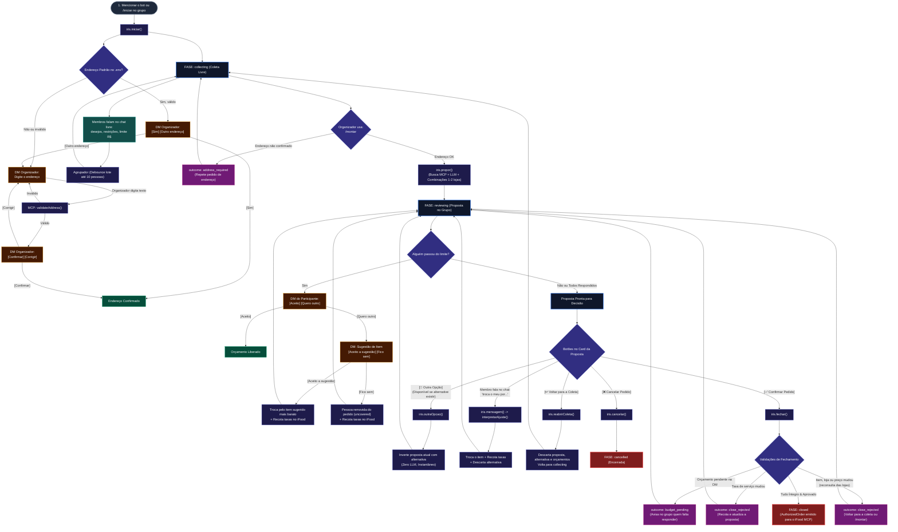

# API do core (Íris) para o bot do Telegram

> **Produção IF-05/IF-06:** `src/index.ts` usa `criarAplicacaoReal` de `src/app.ts`, com `criarAgenteDescoberta`, `DiscoveryCatalogPort`, MCP iFood e Groq reais obrigatórios. O retorno usa `preliminary` e dados do catálogo para o card; não autoriza fechamento. Endereço salvo é confirmado no grupo; orçamento continua privado. O exemplo fake e as seções de `Proposal`/`CatalogPort`/`fechar` abaixo documentam o fluxo cotado preservado para desenvolvimento e testes, não a composição principal. Veja [arquitetura atual](architecture.md) e [IF-06](../src/ifood/IF-06.md).

O bot **não faz requisição HTTP** ao agente: ele importa o core e chama funções no mesmo processo. Toda a regra de negócio (fases, preços, rateio, quem pode fechar) fica no core; o bot só traduz o Telegram para chamadas e apresenta o resultado.

## Montando o agente cotado para desenvolvimento e testes

```ts
import { CatalogoFake, criarAgente, criarLlmDoAmbiente } from './core/index.js';

const iris = criarAgente({
  catalog: new CatalogoFake(),           // trocar pela CatalogPort real do módulo iFood
  llm: criarLlmDoAmbiente(process.env),  // sem AI_PROVIDER: modelo fake, sem rede
  onError: (e) => console.error(e),
  enderecoPadrao: process.env.ENDERECO_PADRAO, // opcional: texto livre; o organizador confirma
});
```

Para desenvolver e testar o fluxo cotado sem chave nem iFood, o exemplo acima usa cinco lojas fictícias e um modelo heurístico. Não substituir a composição real de `src/index.ts` por esse exemplo na demonstração.

## Conceitos: chat, sessão, pessoa e organizador

| Conceito | No Telegram | No core | Por quê |
|---|---|---|---|
| **Chat** | O grupo onde as pessoas conversam (`ctx.chat.id`) | — | É onde o pedido coletivo acontece. |
| **Sessão** | — | Um pedido coletivo em andamento naquele chat (`CoreSession`), com fase, participantes, proposta e fechamento | O core precisa guardar o estado do pedido entre mensagens. |
| **`sessionId`** | `String(ctx.chat.id)` | Identifica a sessão | Ver abaixo. |
| **`participantId`** | `String(ctx.from.id)` | Identifica a pessoa dentro da sessão | O id do usuário é estável: não muda se a pessoa trocar o nome, e é o mesmo em qualquer grupo. |
| **`displayName`** | `ctx.from.first_name` | Nome para mostrar (proposta, justificativa) | Só aparência: nunca use como identidade. É gravado quando a pessoa aparece pela primeira vez. |
| **Organizador** | Quem mencionou o bot (ou usou `/iniciar`) no grupo | `session.organizerId` | A compra só sai com autorização explícita de uma pessoa: só ela monta a proposta, troca de opção, fecha, cancela e reabre. |

### Por que `sessionId` é o id do chat

- **Um pedido por grupo de cada vez.** Enquanto há uma sessão ativa no grupo, uma nova menção ao bot não abre outra (`already_active`); assim ninguém cria dois pedidos paralelos no mesmo chat.
- **O bot não precisa de tabela de mapeamento.** Toda mensagem do Telegram já traz `ctx.chat.id`; usar esse valor como `sessionId` dispensa guardar "qual sessão é deste chat". Em todo o core e nesta documentação o nome é sempre `sessionId`: no bot, é só `String(ctx.chat.id)`.
- **Depois de fechar ou cancelar, o próximo pedido reaproveita o mesmo `sessionId`.** A sessão encerrada é substituída pela nova no armazenamento. Ou seja: `sessionId` identifica "o pedido atual do grupo", **não** um pedido para sempre. Para identificar um pedido específico, use o `proposalId` (abaixo).
- **Por que `String(...)`:** os contratos tratam ids como texto opaco (o core não depende do Telegram). Os ids do Telegram são números (grupos têm id negativo); converter para texto mantém o core independente do canal.

### Mensagem privada x mensagem no grupo

Uma `send_message` **com** `participantId` é para a pessoa, no privado. No Telegram, o chat privado de um usuário tem o mesmo id do usuário: `bot.api.sendMessage(participantId, text)`. Isso só funciona se a pessoa já iniciou conversa com o bot; se falhar, avise no grupo **sem dados privados** (como orçamento). O bot faz assim: guarda a mensagem, manda no grupo "Fulana, tenho uma mensagem só para você" com um botão que abre a conversa, e entrega o que ficou guardado quando a pessoa manda `/start`. **Sem** `participantId`, a mensagem é para o grupo: envie para o `sessionId` (o id do chat).

### Ids de proposta e de pedido

| Id | Formato | Para que serve |
|---|---|---|
| `proposal.id` | `{sessionId}-p{n}` (ex.: `-100123-p1`), com `-r1`, `-r2` a cada ajuste | Identifica uma proposta. `n` cresce a cada proposta do chat e **não volta a 1** quando um pedido novo começa no mesmo grupo. |
| `alternative.id` | `{proposal.id}-b` | A segunda opção da mesma proposta. |
| `order.proposalId` | O `proposal.id` autorizado | Chave para quem executa a compra não executar duas vezes. |

## Componentes

```text
Telegram ──▶ agrupador (debounce) ──▶ agente (fachada) ──▶ fases do core ──▶ CatalogPort (iFood) / LlmPort (modelo)
   ▲                                       │
   └──────────── Resposta (actions, proposal, order) ◀──┘          SessionStore (sessões em memória)
```

| Componente | O que é | Quem cria | Por que existe |
|---|---|---|---|
| `criarAgente` (fachada) | Ponto único de entrada do bot: `iniciar`, `mensagem(ns)`, `confirmarEndereco`, `pedirOutroEndereco`, `propor`, `outraOpcao`, `responderOrcamento`, `fechar`, `cancelar`, `reabrirColeta`, `obter`, `nomes` | `src/index.ts` | O bot não precisa saber de fases, catálogo nem modelo; e erros esperados viram `outcome`, não exceção. Processa um chat por vez, para duas pessoas falando juntas não sobrescreverem o pedido. |
| `criarAgrupador` | Junta mensagens quase simultâneas do mesmo chat (debounce) e envia como lote | `src/index.ts` (ou o bot) | O provedor gratuito limita tokens por minuto: 10 mensagens viram 1 chamada ao modelo. |
| `SessionStore` | Onde as sessões ficam (`SessoesEmMemoria` por padrão) | Opcional no `criarAgente` | Separar o armazenamento permite trocar por persistência sem mudar o agente. Em memória, reiniciar o processo perde os pedidos em andamento. |
| `CatalogPort` | Leitura do catálogo: `validateAddress`, `searchStores`, `getMenu`, e cotação da taxa de serviço: `quoteOrder` | Módulo iFood (hoje, `CatalogoFake`) | O core não conhece as ferramentas do MCP; o módulo iFood traduz para `Store` e `MenuItem`, em centavos. |
| `LlmPort` | Acesso ao modelo de IA | `criarLlmDoAmbiente(process.env)` | Trocar de provedor é só mudar o `.env`. Sem `AI_PROVIDER`, usa um modelo fake, sem rede. |
| `Resposta` | Retorno de toda chamada: `outcome`, `actions` e dados (`proposal`, `alternative`, `order`) | O agente | O bot só apresenta: envia as `actions` e desenha os dados. |
| `CoreAction` | O que enviar: mensagem (grupo ou privada), pergunta com botões (endereço, orçamento) ou "sessão atualizada" | O agente | Texto e destino já decididos pelo core (ex.: o que é privado). |
| `Proposal` | Proposta com pedidos por loja, rateio, substitutos e justificativa | O agente | É o que o grupo vê e confirma. Valores sempre calculados pelo código. |
| `AuthorizedOrder` | Pedido autorizado pelo organizador | O agente, ao fechar | Fronteira com quem executa a compra no iFood. O core não compra nada. |

## Chamadas

Nas chamadas abaixo, `sessionId` é `String(ctx.chat.id)` e `actorId` é o `participantId` de quem apertou o botão, `String(ctx.from.id)`. O core usa sempre esses dois nomes.

Todas devolvem `Promise<Resposta>` e **não lançam exceção** para casos esperados: o resultado vem em `outcome`.

| Evento no Telegram | Chamada |
|---|---|
| Alguém menciona o bot ou usa `/iniciar` no grupo | `iris.iniciar(sessionId, { id, displayName })` — quem iniciou vira organizador |
| Mensagem no grupo durante o pedido | `agrupador.adicionar(...)` (recomendado, ver "Mensagens em lote") ou `iris.mensagem({ sessionId, participantId, text }, displayName)` |
| Botões do endereço ([Sim], [Confirmar], [Outro endereço], [Corrigir]) | `iris.confirmarEndereco` ou `iris.pedirOutroEndereco` (ver "Endereço de entrega") |
| Comando `/montar` | `iris.propor(sessionId, actorId)` |
| Botão "Outra opção" | `iris.outraOpcao(sessionId, actorId)` |
| Botões do orçamento ([Aceito], [Quero outro], [Aceito a sugestão], [Fico sem]) | `iris.responderOrcamento(sessionId, participantId, resposta)` (ver "Orçamento") |
| Botão "Confirmar pedido" | `iris.fechar(sessionId, actorId)` |
| Botão "Voltar para a coleta" | `iris.reabrirColeta(sessionId, actorId)` |
| Botão "Cancelar pedido" ou comando `/cancelar` | `iris.cancelar(sessionId, actorId)` |
| Mostrar estado | `iris.obter(sessionId)` |
| Nomes de lojas e itens para desenhar a proposta ou o pedido | `iris.nomes(sessionId)` (ver "Desenhando a proposta") |

Não precisa checar se quem clicou é o organizador: o core recusa com `outcome: 'not_authorized'` e já devolve a mensagem privada. Mensagens de pessoas diferentes no mesmo grupo podem chegar ao mesmo tempo: o core processa uma de cada vez por grupo.

`mensagem` decide sozinha o que fazer pela fase: na coleta registra preferências; com proposta na mesa interpreta pedidos de troca ("troca o meu por um café").

## Árvore de Processos e Fluxo dos Botões

O ciclo de vida de um pedido coletivo na Íris é governado por uma máquina de estados finita (FSM) estrita. Cada botão apresentado na interface corresponde a um método da fachada, com regras claras de **quem pode clicar**, **o que acontece com o estado**, **o que é mantido ou descartado** e **quais ramificações são abertas**.

### 1. Diagrama Geral da Árvore de Decisão e Botões



---

### 2. Matriz Completa de Botões e Processos

| Fase Atual | Canal / Onde Aparece | Botão / Ação | Quem Pode Clicar | Método da API Core | Efeito no Estado e no Fluxo | O que é Mantido vs. Descartado |
|---|---|---|---|---|---|---|
| Início / Coleta | DM Privada (Organizador) | **[Sim]** (endereço padrão) ou **[Confirmar]** (digitado) | Só Organizador | `iris.confirmarEndereco` | Confirma o endereço da sessão. Se já havia proposta na mesa, ela é descartada. | Valida e salva `address.confirmed`. |
| Início / Coleta | DM Privada (Organizador) | **[Outro endereço]** ou **[Corrigir]** | Só Organizador | `iris.pedirOutroEndereco` | Pede que o organizador digite o novo endereço na DM. | Transita status do endereço para `awaiting_text`. |
| `collecting` | Chat do Grupo | Mensagem de texto livre | Qualquer membro | `agrupador.adicionar` ou `iris.mensagem` | Extrai preferências, restrições e orçamentos via LLM `fast`. | Atualiza as preferências do participante no Core. |
| `collecting` | Chat do Grupo | Comando **`/montar`** | Só Organizador | `iris.propor` | Busca lojas no MCP, combina 1-2 lojas, cota taxas de serviço e apresenta a proposta. Transita para `reviewing`. | **Cria** `proposal` e `alternative`. Inicia checagem de orçamento. |
| `reviewing` | Chat do Grupo | **[🔄 Outra opção]** *(condicional)* | Só Organizador | `iris.outraOpcao` | **Troca instantânea** (`outcome: 'switched'`): a alternativa vira a proposta principal e a principal vira alternativa. | **Mantém** ambas as opções trocadas de lugar. **Reinicia** perguntas de orçamento para os novos itens. |
| `reviewing` | Chat do Grupo | **[↩️ Voltar para a coleta]** | Só Organizador | `iris.reabrirColeta` | **Reabre a coleta livre** (`outcome: 'collecting'`): descarta a proposta e permite que novas pessoas entrem ou alterem seus pedidos. | **Descarta** `proposal`, `alternative` e `budget`. **Mantém** lista de participantes e preferências já colhidas. |
| Qualquer fase ativa | Chat do Grupo | **[❌ Cancelar pedido]** ou **`/cancelar`** | Só Organizador | `iris.cancelar` | Encerra a sessão imediatamente com status `cancelled` (`outcome: 'cancelled'`). | Sessão finalizada. Não aceita mais ações. |
| `reviewing` | Chat do Grupo | Mensagem de texto (ex: *"troca por X"*) | Qualquer participante | `iris.mensagem` / agrupador | Interpreta o ajuste (`interpretarAjuste`) e troca o item daquela pessoa no cardápio da loja. | **Atualiza** `proposal` (nova revisão `-r1`). **Descarta** `alternative`. Recota taxas e reavalia orçamento. |
| `reviewing` | DM Privada (Participante) | **[Aceito]** (estouro de valor) | Próprio participante | `iris.responderOrcamento(..., 'aceito')` | Confirma que aceita pagar a quantia real com frete e taxa. | Registra aceite em `budget.aceitos`. Desbloqueia o participante. |
| `reviewing` | DM Privada (Participante) | **[Quero outro]** (estouro de valor) | Próprio participante | `iris.responderOrcamento(..., 'quero_outro')` | O Core sugere o item mais barato daquela loja que caiba no orçamento. | Envia `item_suggestion` na DM com novos botões. |
| `reviewing` | DM Privada (Participante) | **[Aceito a sugestão]** | Próprio participante | `iris.responderOrcamento(..., 'aceito_sugestao')` | Substitui o item caro pelo sugerido mais em conta. | **Troca o item** na proposta. Recota taxas no iFood. Reavalia orçamento em cascata. |
| `reviewing` | DM Privada (Participante) | **[Fico sem]** | Próprio participante | `iris.responderOrcamento(..., 'fico_sem')` | Remove a pessoa do pedido coletivo. | Move a pessoa para `uncoveredParticipantIds`. Recota taxas para os que ficaram. |
| `reviewing` | Chat do Grupo | **[✅ Confirmar pedido]** | Só Organizador | `iris.fechar` | Reconsulta as lojas da proposta, recota a taxa de serviço no iFood e emite o `AuthorizedOrder`. Transita para `closed`. Se recusar (`budget_pending`, `close_rejected`, `address_required`), a sessão **continua em `reviewing`**. | **Gera fechamento idempotente.** Pronto para submissão no iFood. |

---

### 3. Detalhamento dos Processos-Chave

#### Processo A: "Voltar para a Coleta" (`reabrirColeta`)
* **Oportunidade no Fluxo:** Fica disponível como botão no rodapé do card da proposta durante toda a fase `reviewing`.
* **Quem pode acionar:** Apenas o organizador (`actorId === session.organizerId`). Se outro membro clicar, o Core responde `outcome: 'not_authorized'` com aviso privado.
* **Por que foi criado?** Em cenários reais, enquanto o grupo olha a proposta, pode acontecer de:
  1. Entrar um colega novo no grupo que também quer pedir;
  2. Alguém desistir completamente e querer pedir algo de outra culinária;
  3. O grupo perceber que ninguém quer as lojas sugeridas.
* **Comportamento do Core:**
  - A sessão transita de `reviewing` para `collecting`.
  - A proposta (`proposal`), a alternativa (`alternative`) e as perguntas de orçamento (`budget`) são **completamente descartadas**.
  - **Atenção:** Os participantes que já mandaram mensagens e suas preferências anteriores continuam salvos! Assim, quem já escolheu não precisa digitar tudo de novo; apenas os ajustes necessários são feitos no chat antes de o organizador usar `/montar` novamente.

#### Processo B: "Outra Opção" (`outraOpcao`)
* **Oportunidade no Fluxo:** Aparece como botão no card da proposta **se, e somente se**, `resposta.alternative` estiver presente.
* **Quem pode acionar:** Apenas o organizador.
* **Como funciona o algoritmo?** Quando o organizador chama `iris.propor`, o motor combinatório do Core calcula as duas melhores combinações de lojas e itens: a 1ª colocada (`proposal`) e a 2ª colocada (`alternative`), já com as justificativas geradas pelo modelo.
* **Efeito "Gangorra" (Toggle):** Ao clicar em `[Outra Opção]`, o Core executa `trocarPorAlternativa`:
  $$\text{proposal} \longleftrightarrow \text{alternative}$$
  Essa troca é **100% em código puro**, levando **0 milissegundos e 0 tokens de IA**. Se o grupo não gostar da segunda opção e o organizador clicar de novo, o sistema volta instantaneamente para a primeira!
* **Quando o botão desaparece?** Se alguém no grupo fizer um ajuste manual de itens por texto (ex.: *"troca meu refri por suco"*), a proposta ganha uma nova revisão (`-r1`) e a `alternative` anterior é descartada (o botão "Outra Opção" deixa de aparecer).

#### Processo C: Ajustes de Itens pelo Chat Livre (`interpretarAjuste`)
* **Oportunidade no Fluxo:** Durante a fase `reviewing`, a qualquer momento antes do fechamento.
* **Quem pode falar:** Qualquer participante do grupo.
* **Como funciona:**
  - Quando a sessão está em `reviewing`, qualquer mensagem enviada no grupo não vai para a coleta geral, mas é direcionada para a função `interpretarAjuste`.
  - Apenas o participante dono da mensagem pode alterar os seus próprios itens (ninguém altera o prato do colega).
  - O Core valida se o item solicitado existe no cardápio da loja já selecionada e se é elegível.
  - Ao aplicar o ajuste: a taxa de serviço é recotada no iFood, o rateio é recalculado deterministamente e as perguntas de orçamento são reavaliadas.

#### Processo D: Resolução Privada de Orçamento e Efeito em Cascata
* **Oportunidade no Fluxo:** Disparado automaticamente assim que uma proposta é montada ou ajustada.
* **A Trava de Fechamento:** Se qualquer membro do grupo tiver seu total (itens + frete rateado + taxa rateada) maior que o orçamento informado na coleta, a Íris **bloqueia o fechamento do pedido**.
* **Comunicação Segura:**
  - O participante recebe uma mensagem privada (DM) com botões inline.
  - No grupo, o bot apenas emite: *"⏳ Aguardando confirmação individual de valores de: @Nome"*. Valores em reais nunca são expostos publicamente.
* **Efeito em Cascata (Efeito Dominó):** Se o participante responder `[Quero outro]` e trocar por um item mais barato, ou responder `[Fico sem]` e sair do pedido, a taxa de entrega e de serviço das outras pessoas é redistribuída. Se essa redistribuição fizer um segundo participante estourar seu orçamento, a Íris envia uma nova pergunta privada para essa segunda pessoa automaticamente!

#### Processo E: Fechamento com Autorização Sagrada e Idempotência (`fechar`)
* **Oportunidade no Fluxo:** Botão `[✅ Confirmar pedido]` no card da proposta.
* **Quem pode acionar:** Exclusivamente o organizador.
* **Validações Pré-Fechamento:**
  1. *Endereço:* Sem endereço confirmado, recusa com `outcome: 'address_required'` e repete o pedido de endereço no privado.
  2. *Reconsulta das lojas:* O Core sempre consulta de novo, no iFood, as lojas da proposta (cardápio, preço, loja aberta) e só aceita um retrato com no máximo 60 segundos.
  3. *Orçamentos pendentes:* Se houver pendências em `pendingBudget`, recusa com `outcome: 'budget_pending'`.
  4. *Recotação de taxa de serviço:* O Core cota novamente a taxa no MCP. Se o iFood tiver alterado a taxa (ou não der para cotar), o fechamento é suspenso com `outcome: 'close_rejected'`, a proposta é atualizada com a nova taxa e o grupo é avisado.
  5. *Catálogo:* Se um item esgotou, a loja fechou ou um preço mudou, recusa com `outcome: 'close_rejected'` e os `problems`, sem atualizar a proposta: o organizador volta para a coleta ou usa `/montar` de novo.
* **Recusa não trava a sessão:** em qualquer recusa a sessão **continua em `reviewing`**. Dá para ajustar, trocar de opção, voltar para a coleta, montar de novo ou tentar fechar outra vez. (`awaiting_confirmation` só existe durante o fechamento.)
* **Idempotência:** Após a emissão do `AuthorizedOrder`, a sessão vai para `status: 'closed'`. Se o organizador tocar duas vezes no botão por instabilidade de rede, o Core devolve `outcome: 'already_closed'` com o mesmo pedido, impedindo cobranças duplicadas. O bot entrega o pedido ao executor só no `closed`.

---

## Mensagens em lote (use isto no grupo)

O provedor gratuito limita tokens por minuto. Se 10 pessoas mandarem mensagem quase juntas, `iris.mensagem` faria 10 chamadas ao modelo. Com o **agrupador**, elas viram **uma** chamada (até 10 pessoas por chamada):

```ts
import { criarAgrupador } from './core/index.js';

const agrupador = criarAgrupador(iris, {
  esperaMs: 2000,     // envia 2 s depois da última mensagem (debounce)
  esperaMaxMs: 6000,  // ...ou no máximo 6 s depois da primeira, mesmo com gente digitando
  maxLote: 10,        // ...ou na hora, ao juntar 10 mensagens
  aoResponder: async (sessionId, resposta) => {
    // mesmas regras de sempre: envie resposta.actions, desenhe resposta.proposal se vier
  },
  onError: (e) => console.error(e),
});

bot.on('message:text', (ctx) => {
  agrupador.adicionar(
    { sessionId: String(ctx.chat.id), participantId: String(ctx.from.id), text: ctx.message.text },
    ctx.from.first_name,
  );
});

// Antes de propor, fechar, cancelar ou reabrir, envie o que estiver pendente:
await agrupador.esvaziar(sessionId);
await iris.propor(sessionId, actorId);
```

- `adicionar` não espera o modelo; a resposta chega em `aoResponder`, uma vez por lote.
- Mensagens da mesma pessoa no mesmo lote são lidas juntas, em ordem (a última vale se ela mudou de ideia).
- Na proposta, o lote é processado como ajustes, um por mensagem, em ordem.
- `resposta.resultados` traz o outcome de cada pessoa (`{ participantId, outcome }[]`), útil para reagir à mensagem certa (ex.: 👍).
- Sem o agrupador, dá para chamar direto `iris.mensagens(sessionId, [{ participantId, text, displayName }, ...])`.
- Ao desligar o bot: `await agrupador.esvaziarTudo()`.

## Endereço de entrega

O iFood só busca lojas e cardápios para um endereço, então todo pedido precisa de um **endereço confirmado pelo organizador**. O fluxo corre em paralelo à coleta (as pessoas podem mandar preferências enquanto o endereço é definido) e **o modelo não participa**.

```text
iniciar ──▶ com enderecoPadrao válido: confirm_address (kind "default") → [Sim] [Outro endereço]
        └─▶ sem padrão (ou inválido):   request_address → organizador digita no privado

[Outro endereço] / [Corrigir] ──▶ request_address → organizador digita no privado
texto digitado ──▶ porta do iFood valida ──▶ válido:   confirm_address (kind "typed") → [Confirmar] [Corrigir]
                                          └─▶ inválido: mensagem privada com o motivo; ele digita de novo
[Sim] / [Confirmar] ──▶ endereço confirmado (se mudou com proposta na mesa, a proposta é descartada)
```

| Botão (no privado do organizador) | Chamada |
|---|---|
| **[Sim]** (padrão) ou **[Confirmar]** (digitado) | `iris.confirmarEndereco(sessionId, actorId)` |
| **[Outro endereço]** (padrão) ou **[Corrigir]** (digitado) | `iris.pedirOutroEndereco(sessionId, actorId)` |

Regras:

- **Só o organizador** confirma ou troca o endereço (os outros recebem `not_authorized`).
- **O texto do endereço chega pelo caminho normal das mensagens** (`agrupador.adicionar` ou `iris.mensagem`): enquanto a sessão espera o endereço, a mensagem **do organizador** vai para a validação, **nunca para a coleta**. As mensagens dos outros seguem para a coleta normalmente. O bot não precisa de nenhum tratamento especial; basta encaminhar também as mensagens do privado do organizador com o `sessionId` do grupo (veja abaixo).
- **A coleta não espera** o endereço. **Propor e fechar exigem** endereço confirmado: sem ele, o core responde `address_required` e repete o pedido de endereço (ou de confirmação) nas actions.
- **Trocar o endereço depois da proposta descarta a proposta** (a sessão volta para a coleta) e avisa o grupo: lojas, preços e entrega dependem do endereço. Confirmar o mesmo endereço de novo não descarta nada.
- Endereço padrão: passe em `criarAgente({ ..., enderecoPadrao })` (texto livre, por exemplo vindo do `.env`). O core valida pela porta do iFood antes de oferecer.

**Mensagem privada do organizador → sessão do grupo.** Quando o organizador digita o endereço no privado, `ctx.chat.id` é o chat privado, não o grupo. O bot precisa lembrar de qual grupo veio o `request_address` (ex.: um mapa `organizador → sessionId do grupo`, preenchido ao enviar o `request_address`) e encaminhar a mensagem com o `sessionId` **do grupo**.

## Orçamento

"Até 30 reais" cobre **tudo o que a pessoa paga**: itens + parte da entrega + parte da taxa de serviço. Entrega e taxa de serviço são divididas igualmente entre quem pediu na loja.

- **A taxa de serviço vem do iFood** (`CatalogPort.quoteOrder`). O core cota só a proposta escolhida e a alternativa, uma vez por loja, e de novo no fechamento. Se a cotação falhar, a proposta sai sem a taxa (`serviceFeeCents` ausente) e o grupo recebe um aviso.
- **Quem passar do orçamento, de qualquer valor, é perguntado no privado.** O item não sai do pedido sozinho: a pessoa decide.
- **Só a própria pessoa responde.** Outra pessoa apertando o botão recebe `budget_nothing_pending`.
- **O fechamento fica bloqueado** até todos responderem: `fechar` devolve `budget_pending`, com os ids em `pendingBudget` e um aviso ao grupo com os nomes (sem valores).

```text
budget_question ──▶ [Aceito]      → budget_accepted (valor confirmado)
                └─▶ [Quero outro] → item_suggestion com item  → [Aceito a sugestão] → budget_item_swapped
                                  │                           └─▶ [Fico sem]         → budget_left_out
                                  └─▶ item_suggestion sem item → [Fico sem]          → budget_left_out
```

| Botão | `resposta` |
|---|---|
| [Aceito] | `'aceito'` |
| [Quero outro] | `'quero_outro'` |
| [Aceito a sugestão] | `'aceito_sugestao'` |
| [Fico sem] | `'fico_sem'` |

```ts
// No callback do botão (no privado): quem respondeu é quem clicou;
// o sessionId do grupo veio na action budget_question (guarde no callback_data ou num mapa).
const r = await iris.responderOrcamento(sessionIdDoGrupo, String(ctx.from.id), 'aceito');
```

Como no endereço, os botões ficam no privado da pessoa: o bot precisa lembrar de qual grupo veio a pergunta (o `sessionId` está na action) e chamar com o `sessionId` **do grupo**.

Regras que o core já aplica:

- **A sugestão** troca o item mais caro da pessoa pelo mais próximo do que ela pediu (primeiro os que atendem, depois os substitutos) que caiba no orçamento, só nas lojas que já estão no pedido.
- **[Fico sem]** tira a pessoa do pedido (ela vai para `uncoveredParticipantIds`). Se ninguém sobrar com item, a sessão volta para a coleta.
- **Efeito em cascata:** quando alguém troca de item ou sai, a entrega e a taxa são redivididas e a taxa é cotada de novo. Quem passar a estourar por isso recebe uma pergunta nova. As outras respostas continuam valendo.
- **Respostas zeradas:** ajuste feito pelo grupo, "Outra opção", troca de endereço ou proposta nova recomeçam as perguntas.
- **Aceite vale para o valor aceito:** se o total da pessoa subir depois (por exemplo, a taxa mudou), ela é perguntada de novo.
- **No fechamento, a taxa é cotada de novo.** Se mudou, o fechamento é recusado (`close_rejected` com `service_fee_changed`), a proposta é atualizada e quem passar a estourar é perguntado. Se não der para cotar, `close_rejected` com `service_fee_unavailable`.

## `Resposta`

```ts
interface Resposta {
  outcome: string;            // ver tabela abaixo
  actions: CoreAction[];      // envie todas, na ordem
  session?: CoreSession;
  proposal?: Proposal;        // desenhar quando vier
  alternative?: Proposal;     // segunda melhor combinação, para o botão "Outra opção"
  order?: AuthorizedOrder;    // pedido autorizado (fechamento)
  problems?: ProblemaProposta[];
  pendingBudget?: ParticipantId[]; // quem ainda precisa responder sobre o valor (bloqueia o fechamento)
  discarded?: Descarte[];     // diagnóstico; não precisa mostrar
  uncertain?: ItemIncerto[];  // itens a confirmar com quem tem restrição
}
```

### `actions`

- `send_message` **com** `participantId`: mensagem só para aquela pessoa (pergunta de esclarecimento, recusa, aviso). Bots só conseguem mandar DM para quem já iniciou conversa com eles; se falhar, responda no grupo em reply à mensagem da pessoa.
- `send_message` **sem** `participantId`: mensagem para o grupo.
- `session_updated`: a sessão mudou; use para atualizar o que estiver na tela, se quiser.
- `request_address`: peça ao organizador, **no privado**, que digite o endereço (`text` já traz a pergunta).
- `confirm_address`: mostre ao organizador, **no privado**, o `text` e os botões: `kind: "default"` → [Sim] [Outro endereço]; `kind: "typed"` → [Confirmar] [Corrigir]. O endereço normalizado está em `address.formatted`.
- `budget_question`: mostre à pessoa (`participantId`), **no privado**, o `text` e os botões [Aceito] [Quero outro]. `totalCents` é o valor que ela paga.
- `item_suggestion`: mostre à pessoa, **no privado**, o `text`. Com `menuItemId`: botões [Aceito a sugestão] [Fico sem]. Sem `menuItemId` (não há item que caiba): só [Fico sem].

### `outcome`

| outcome | O que o bot faz |
|---|---|
| `started` / `already_active` | Avisar que o pedido começou / já está em andamento |
| `address_default_proposed` / `address_typed_proposed` / `address_requested` | Enviar a ação de endereço (`confirm_address` ou `request_address`) no privado do organizador |
| `address_invalid` | O motivo já está na mensagem privada; o organizador digita de novo |
| `address_confirmed` | Endereço definido; se a proposta foi descartada, o aviso ao grupo já está nas actions |
| `address_required` | Tentou propor ou fechar sem endereço confirmado; o lembrete já está nas actions |
| `address_nothing_to_confirm` | Botão de confirmar sem endereço pendente (ex.: clique repetido); aviso privado nas actions |
| `batch` | Lote processado: envie as actions; o outcome de cada pessoa está em `resultados` |
| `empty` | Lote vazio; nada a fazer |
| `preference_updated` | Opcional: reagir à mensagem (ex.: 👍) |
| `question` | Já há mensagem privada de confirmação nas actions |
| `clarification` | Já há pergunta privada nas actions |
| `filtered` / `irrelevant` / `not_adjustment` | Nada |
| `not_participant` | Pedido de troca de quem não tem item na proposta; nada a fazer |
| `proposed` / `adjusted` | Desenhar `proposal` com os botões Confirmar / Voltar / Cancelar (e "Outra opção" se vier `alternative`) |
| `switched` | "Outra opção" aplicada: desenhar a nova `proposal` |
| `no_alternative` | Não há outra opção; aviso privado já nas actions |
| `rejected` | Troca recusada; a explicação está nas actions |
| `closed` | Mostrar o resumo de `order` e entregar ao executor do pedido |
| `already_closed` | Mostrar o mesmo resumo; **não** executar de novo |
| `close_rejected` | Algo mudou na taxa de serviço ou no catálogo; a sessão continua em `reviewing`. Com `problems` de taxa (`service_fee_changed` / `service_fee_unavailable`), desenhar a `proposal` atualizada; senão avisar que o catálogo mudou e oferecer "Voltar para a coleta" ou `/montar` |
| `collecting` | "Voltar para a coleta" aplicado: tirar os botões da proposta e avisar o grupo |
| `cancelled` | Pedido cancelado: tirar os botões da proposta e avisar o grupo |
| `budget_pending` | Fechamento bloqueado: há quem não respondeu sobre o valor (`pendingBudget`); o aviso ao grupo já está nas actions |
| `budget_accepted` / `budget_suggested` / `budget_no_suggestion` | Resposta registrada; a mensagem privada (e os botões da sugestão) já estão nas actions |
| `budget_item_swapped` / `budget_left_out` | O pedido mudou: desenhar a nova `proposal` (se vier) |
| `budget_nothing_pending` / `budget_invalid_answer` | Botão sem pergunta pendente ou fora de hora; aviso privado nas actions |
| `no_candidates` / `no_valid_option` / `model_failed` | Não deu para propor; já há mensagem nas actions |
| `not_authorized` / `invalid_state` / `no_session` / `session_finished` | Mensagem privada já nas actions (quando há quem avisar) |
| `error` | Erro inesperado (já registrado em `onError`); mensagem genérica nas actions |

## Desenhando a proposta

- Dinheiro vem em **centavos inteiros**: `2590` → `R$ 25,90` (`(c / 100).toFixed(2).replace('.', ',')`). Nunca some valores no bot: use `subtotalCents`, `totalCents` e `split`.
- Por loja (`proposal.orders`): nome da loja, itens por pessoa, entrega, taxa de serviço (`serviceFeeCents`; ausente = "não cotada") e total.
- **Nomes:** a proposta só traz `storeId` e `menuItemId`. Os nomes vêm de `await iris.nomes(sessionId)` → `{ lojas: { [storeId]: nome }, itens: { [menuItemId]: nome } }`, do catálogo da proposta atual (continua disponível depois de fechar, para o resumo do pedido).
- Rateio (`proposal.split.shares`): quanto cada pessoa paga (`itemsCents` + `deliveryCents` + `serviceCents` = `totalCents`).
- Uma pessoa pode ter **mais de um item** ("um lanche e um bolo de cenoura"): agrupe por `participantId`. No rateio ela aparece uma vez, com a soma dos itens e uma parte da entrega e da taxa de cada loja em que pediu.
- `item.isSubstitute`: marcar como "sugestão parecida" (vale por item).
- `proposal.uncoveredParticipantIds`: quem ficou sem item.
- `proposal.justification`: texto curto da Íris, pode ir no topo.
- **Nunca mostre `preferences.budgetCents` no grupo**: o orçamento é privado.
- **Como o orçamento vale:** "até 30 reais" cobre itens + entrega + taxa de serviço (veja "Orçamento"). Quem passou recebe a pergunta no privado; no grupo, mostre só os nomes de quem falta responder, nunca valores.

## Outra opção

Além da proposta escolhida, `propor` devolve em `resposta.alternative` a **segunda melhor combinação** (com itens diferentes), quando existir. Para o botão "Outra opção":

```ts
const r = await iris.outraOpcao(sessionId, actorId); // só o organizador
// r.outcome === "switched": desenhe r.proposal (a nova atual); r.alternative é a anterior
```

- Apertar de novo volta para a primeira. Não chama o modelo: as duas justificativas já vieram no `propor`.
- Mostre o botão só quando `resposta.alternative` existir. Sem alternativa, `outraOpcao` devolve `no_alternative` com aviso privado.
- Qualquer ajuste (troca de item) gera uma proposta nova e **descarta a alternativa**; reabrir a coleta também.
- Trocar de opção recomeça as perguntas de orçamento para a nova proposta (as actions trazem as perguntas).
- A justificativa é **uma frase objetiva** explicando o trade-off (quem ficou com substituto ou sem item e por quê), sem adjetivos.

## Fechamento

`order` (`AuthorizedOrder`) é a fronteira com quem executa a compra no iFood: pedidos por loja, rateio, a autorização (quem, quando, qual proposta) e o **endereço de entrega confirmado** (`order.deliveryAddress`). O core não compra nada.

- `order.orders[].serviceFeeCents` traz a taxa de serviço cotada no fechamento; o rateio já a inclui.
- Com `already_closed`, o `order` é o mesmo da primeira vez: **não execute de novo**.
- Chave de idempotência para o executor: `order.proposalId`. Ele não se repete entre pedidos do mesmo grupo enquanto o processo estiver no ar. Como as sessões ficam em memória e o contador recomeça se o processo reiniciar, use `${order.proposalId}:${order.authorization.authorizedAt}` se o executor guardar histórico entre reinícios.

## Como o bot do Telegram usa esta API

Implementação em `src/telegram/`; a composição (agente + bot) fica em `src/index.ts`.

### Comandos

| Onde | Comando | O que faz |
|---|---|---|
| Grupo | menção ao bot ou `/iniciar` | `iris.iniciar`. Com pedido ativo, a menção vira mensagem da coleta; `/iniciar` avisa que já existe. |
| Grupo | `/montar` | Esvazia o lote do agrupador e chama `iris.propor`. |
| Grupo | `/cancelar` | Esvazia o lote e chama `iris.cancelar` (o core recusa quem não organizou). |

Toda mensagem de texto (ou legenda) do grupo com pedido ativo vai para o `agrupador`; o core decide pela fase se é preferência ou ajuste. No privado, o bot só aceita o endereço que o core pediu ao organizador.

### Botões e `callback_data`

| Botão | `callback_data` | Chamada |
|---|---|---|
| Card da proposta (grupo): Confirmar / Outra opção / Voltar / Cancelar | `proposta:confirmar` / `proposta:outra` / `proposta:voltar` / `proposta:cancelar` | `fechar` / `outraOpcao` / `reabrirColeta` / `cancelar`, com o `sessionId` do chat do clique |
| Endereço (privado): [Sim]/[Confirmar] e [Outro endereço]/[Corrigir] | `ec:<sessionId>` / `eo:<sessionId>` | `confirmarEndereco` / `pedirOutroEndereco` |
| Orçamento (privado): [Aceito] [Quero outro] [Aceito a sugestão] [Fico sem] | `oa:` / `oq:` / `os:` / `of:` + `<sessionId>` | `responderOrcamento(..., 'aceito' \| 'quero_outro' \| 'aceito_sugestao' \| 'fico_sem')` |

Nos botões do privado o `sessionId` do grupo vai no próprio `callback_data` (no privado, `ctx.chat.id` é o chat da pessoa); cabe nos 64 bytes do Telegram. Para o **texto** digitado no privado (o endereço), o bot lembra o grupo da última mensagem privada enviada a cada pessoa.

### Regras de apresentação

- **Um card ativo por grupo:** ao desenhar outra proposta (outra opção, ajuste, sugestão aceita, taxa mudou) ou quando ela sai da mesa (voltar, cancelar, endereço trocado, pedido fechado), os botões do card anterior são retirados.
- **"Outra opção"** só aparece quando a sessão tem `alternative`.
- **Uma pergunta de valor ativa por pessoa:** uma pergunta nova (efeito cascata, outra opção, ajuste) tira os botões da anterior, para ninguém aceitar um valor que não é mais o atual.
- **[Aceito]** atualiza o card no lugar (sai da lista "Aguardando confirmação de valor"); quando ninguém mais falta, o grupo é avisado.
- **`not_authorized` em botão do grupo** vira aviso no próprio botão (`answerCallbackQuery`), sem mensagem privada.
- **Fechamento:** `closed` mostra o resumo (endereço, lojas, rateio, quem autorizou, `proposalId`) e entrega o `AuthorizedOrder` ao executor (`criarBot(token, iris, { aoAutorizar })`; sem executor configurado, só registra no log). `already_closed` mostra o mesmo resumo e **não** chama o executor.
