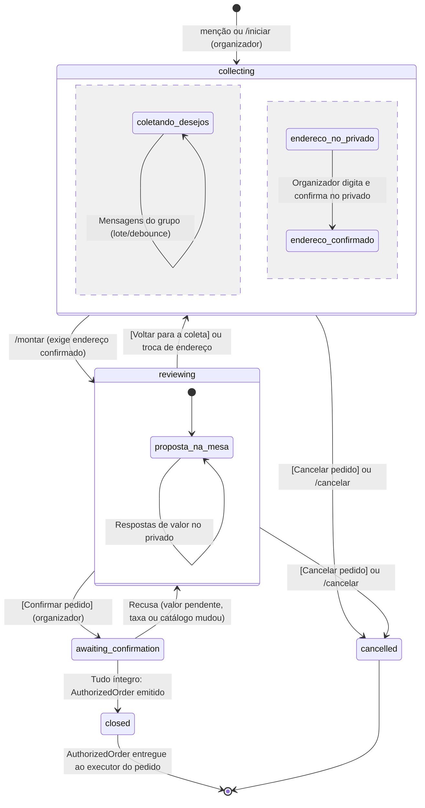
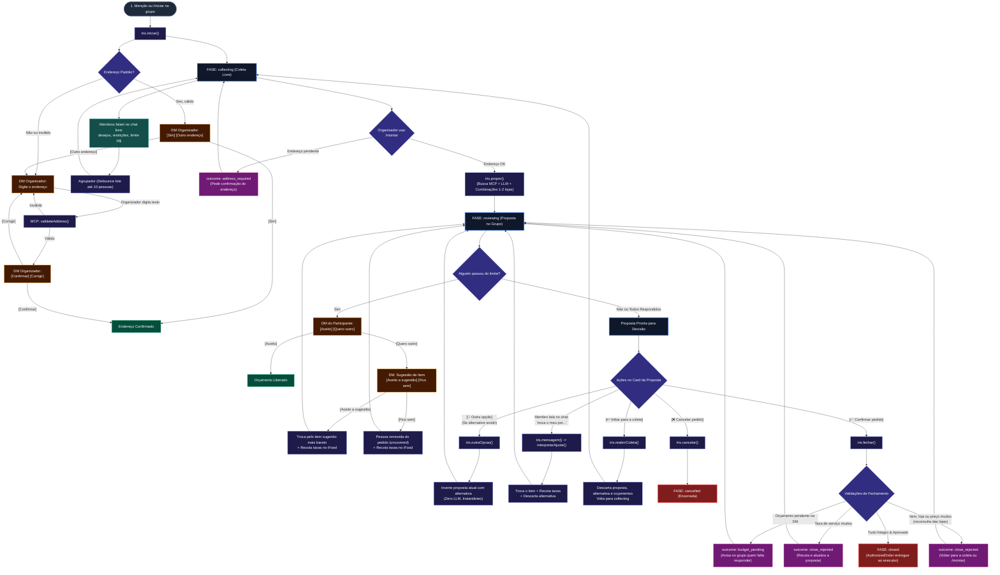
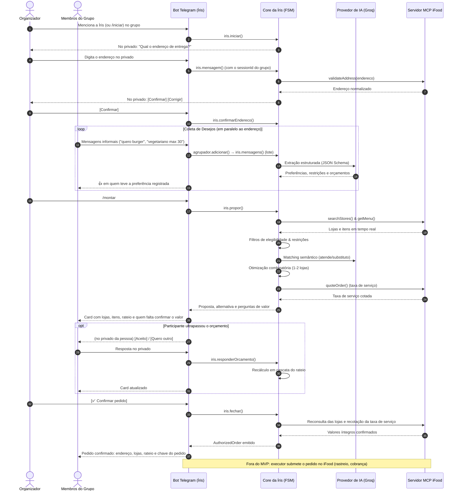

# 02 — Desenho de Solução: Arquitetura e Fluxo Geral da Íris

**Projeto:** Íris (foodjam)  
**Hackathon:** SEMCOMP × iFood 2026 — *Desafio: Vendendo com Agentes*  
**Módulo:** Arquitetura do Sistema e Engenharia de Fluxo  

---

## 1. Visão Geral da Solução

A Íris foi projetada sob o princípio da **inteligência híbrida**: a flexibilidade da linguagem natural é combinada à confiabilidade matemática de uma máquina de estados estrita. A inteligência artificial interpreta o que as pessoas querem; o código garante que o dinheiro, as restrições alimentares e a autorização final sejam 100% determinísticos.

```
┌─────────────────────────────────────────────────────────────────────────────┐
│                            FLUXO DE INTEGRAÇÃO                              │
│                                                                             │
│  Telegram Chat ──▶  Agrupador (Debounce) ──▶  Core da Íris (State Machine)  │
│                                                       │                     │
│                             ┌─────────────────────────┴──────────────────┐  │
│                             ▼                                            ▼  │
│                    LLM Gateway (Groq)                          MCP do iFood  │
│               - Classificação de desejos                   - Validação endereço│
│               - Matching semântico de itens                - Busca de lojas │
│               - Justificativas contextuais                 - Cardápios reais│
│                                                            - Cotação taxas  │
└─────────────────────────────────────────────────────────────────────────────┘
```

---

## 2. Máquina de Estados da Sessão

Diferente de agentes ReAct autônomos que podem entrar em loops infinitos ou tomar decisões imprevisíveis, a Íris opera como uma **Máquina de Estados Finita (FSM)**:



### Árvore Detalhada de Processos e Botões



---

## 3. O Fluxo de Solução Passo a Passo

### Etapa 1: Início e Confirmação de Endereço
1. O organizador adiciona a Íris ao grupo e a menciona (ou digita `/iniciar`): ele vira o organizador do pedido.
2. A Íris propõe o endereço padrão ([Sim] [Outro endereço]) ou pede que o organizador digite o endereço, **no privado**.
3. O endereço textual é normalizado e verificado pela porta do catálogo (`CatalogPort.validateAddress`), implementada pelo adaptador do MCP do iFood; válido, volta com [Confirmar] [Corrigir].
4. A coleta no grupo **não espera** o endereço; montar a proposta e fechar o pedido exigem endereço confirmado.

### Etapa 2: Coleta de Preferências em Linguagem Natural
1. Os membros do grupo mandam mensagens espontâneas no chat: *"quero um x-bacon"*, *"algo vegetariano até R$ 35"*, *"não gosto de cebola"*.
2. **Debounce Inteligente (`criarAgrupador`):** Mensagens enviadas quase simultâneas são acumuladas em uma janela de tempo e processadas em um único lote (reduzindo chamadas e tokens em mais de 70%).
3. O modelo rápido (`fast`: Qwen 27B) extrai estruturadamente: preferências gastronômicas, desejos específicos de itens (`wishes`), restrições alimentares duras (`dietaryRestrictions`), rejeições (`avoids`) e limites de orçamento (`budgetCents`).
4. **Isolamento de Segurança:** O orçamento informado nunca entra no prompt de terceiros e não é revelado no grupo.

### Etapa 3: Busca no iFood e Filtro Rígido de Elegibilidade
1. O Core consulta o catálogo do iFood (`searchStores` e `getMenu`) em estabelecimentos reais abertos que entregam no endereço.
2. O código de elegibilidade (`regras/elegibilidade.ts`) executa uma triagem estrita em memória:
   - Itens que violam restrições dietéticas (ex.: carne para quem é vegetariano) são **automaticamente eliminados**.
   - Itens cujo valor unitário supera o orçamento do participante são **descartados**.
   - Bebidas são impedidas de substituir pratos principais de comida.

### Etapa 4: Matching Semântico e Otimizador Combinatório
1. O modelo avançado (`capable`: GPT OSS 120B) apenas classifica a adequação semântica entre cada desejo e os itens disponíveis: *"atende"*, *"substituto"* ou *"não serve"*.
2. O algoritmo combinatório (`regras/combinacoes.ts`) enumera todas as combinações viáveis de **1 ou no máximo 2 lojas parceiras** (evitando dispersão de entrega).
3. Critério matemático de desempate da melhor proposta:
   $$\text{Mais pessoas atendidas} > \text{Menos desejos vazios} > \text{Menos substitutos} > \text{Menos lojas} > \text{Dentro do orçamento} > \text{Menor total}$$
4. O motor guarda a melhor proposta (`proposal`) e a segunda melhor (`alternative`), permitindo alternância instantânea pelo botão *"Outra Opção"*.

### Etapa 5: Cotação Oficial de Taxas e Rateio Justo
1. A taxa de entrega vem do catálogo da loja; a **taxa de serviço** é cotada no iFood por `CatalogPort.quoteOrder`, uma vez por loja da proposta (e de novo no fechamento).
2. O rateio é calculado em centavos inteiros (`MoneyCents`):
   - Cada participante assume o valor exato dos seus itens.
   - O frete e a taxa de serviço de cada loja são divididos igualmente entre quem pediu naquela loja.
   - Centavos residuais são atribuídos determinística e transparentemente via algoritmo dos maiores resíduos.

### Etapa 6: Resolução Privada de Orçamento
1. Se a soma (itens + frete rateado + taxa de serviço) exceder o limite privado do participante:
   - A Íris **chama a pessoa no privado** com botões inline: `[Aceito]` ou `[Quero outro]`.
   - Se escolher `[Quero outro]`, o código sugere o item compatível mais próximo que caiba no orçamento (`[Aceito a sugestão]` ou `[Fico sem]`).
   - O grupo vê apenas o nome de quem falta responder, preservando total sigilo sobre valores; o fechamento fica bloqueado até todos responderem.
   - Efeito cascata: se alguém troca de item ou sai, a entrega e a taxa são redivididas; quem passar a estourar recebe uma pergunta nova.

### Etapa 7: Fechamento com Autorização Sagrada
1. O organizador clica em `[✅ Confirmar pedido]` (só ele pode; os demais recebem um aviso no próprio botão).
2. O core reconsulta no iFood as lojas da proposta (itens, preços, loja aberta) e recota a taxa de serviço.
3. Se a taxa mudou, a proposta volta atualizada para o grupo confirmar de novo; se um item esgotou ou um preço mudou, o fechamento é recusado e o organizador volta para a coleta ou usa `/montar`. Em qualquer recusa a proposta continua em revisão.
4. Estando tudo válido, é emitido o `AuthorizedOrder` (pedidos por loja, rateio, endereço e autorização), entregue uma única vez ao executor do pedido. Clicar de novo devolve o mesmo pedido, sem duplicar.
5. **Fora do MVP:** o core não compra nada. Submeter o pedido no iFood, rastreio e cobrança ficam para o executor de pedidos, ainda não implementado.

---

## 4. Diagrama de Sequência de Ponta a Ponta



